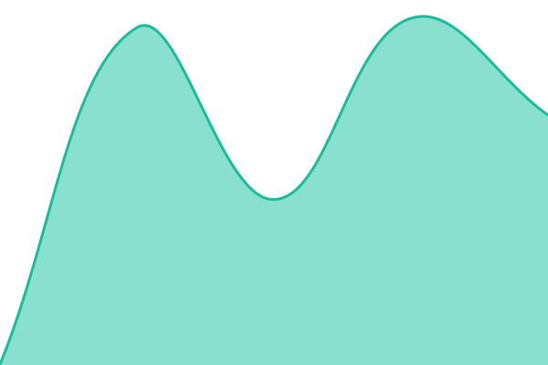

# [📈 Live Status](https://status.wegotworkspace.com): <!--live status--> **🟩 All systems operational**

This repository contains the open-source uptime monitor and status page for [WeGotWorkspace](https://wegotworkspace.org), powered by [Upptime](https://github.com/upptime/upptime).

With [Upptime](https://upptime.js.org), you can get your own unlimited and free uptime monitor and status page, powered entirely by a GitHub repository. We use [Issues](https://github.com/WeGotWorkspace/status/issues) as incident reports, [Actions](https://github.com/WeGotWorkspace/status/actions) as uptime monitors, and [Pages](https://status.wegotworkspace.com) for the status page.

<!--start: status pages-->
<!-- This summary is generated by Upptime (https://github.com/upptime/upptime) -->
<!-- Do not edit this manually, your changes will be overwritten -->
<!-- prettier-ignore -->
| URL | Status | History | Response Time | Uptime |
| --- | ------ | ------- | ------------- | ------ |
|  [Web app](https://demo.wegotworkspace.com/) | 🟩 Up | [web-app.yml](https://github.com/WeGotWorkspace/status/commits/HEAD/history/web-app.yml) | 

 847ms
     
 | 

<a href="https://status.wegotworkspace.com/history/web-app">99.62%</a>
    

|  [API](https://demo.wegotworkspace.com/api/v1/health) | 🟩 Up | [api.yml](https://github.com/WeGotWorkspace/status/commits/HEAD/history/api.yml) | 

 735ms
     
 | 

<a href="https://status.wegotworkspace.com/history/api">99.63%</a>
    

|  [File sync (WebDAV)](https://demo.wegotworkspace.com/files/) | 🟩 Up | [file-sync-web-dav.yml](https://github.com/WeGotWorkspace/status/commits/HEAD/history/file-sync-web-dav.yml) | 

 800ms
     
 | 

<a href="https://status.wegotworkspace.com/history/file-sync-web-dav">100.00%</a>
    

|  [Calls (TURN)](turn.wegotworkspace.com) | 🟩 Up | [calls-turn.yml](https://github.com/WeGotWorkspace/status/commits/HEAD/history/calls-turn.yml) | 

 144ms
     
 | 

<a href="https://status.wegotworkspace.com/history/calls-turn">100.00%</a>
    

|  [Monitoring](https://alive.wegotworkspace.com/) | 🟩 Up | [monitoring.yml](https://github.com/WeGotWorkspace/status/commits/HEAD/history/monitoring.yml) | 

 678ms
     
 | 

<a href="https://status.wegotworkspace.com/history/monitoring">99.65%</a>
    

<!--end: status pages-->

[**Visit our status website →**](https://status.wegotworkspace.com)

The page is `status-page/index.html`, not Upptime's stock site (Static Site CI stays disabled). The Status page workflow runs `status-page/build.mjs` after every check to turn `history/` and the incident issues into `status.json` and publishes both to gh-pages.

## 📄 License

- Powered by: [Upptime](https://github.com/upptime/upptime)
- Code: [MIT](./LICENSE) © [Anand Chowdhary](https://anandchowdhary.com)
- Data in the `./history` directory: [Open Database License](https://opendatacommons.org/licenses/odbl/1-0/)
